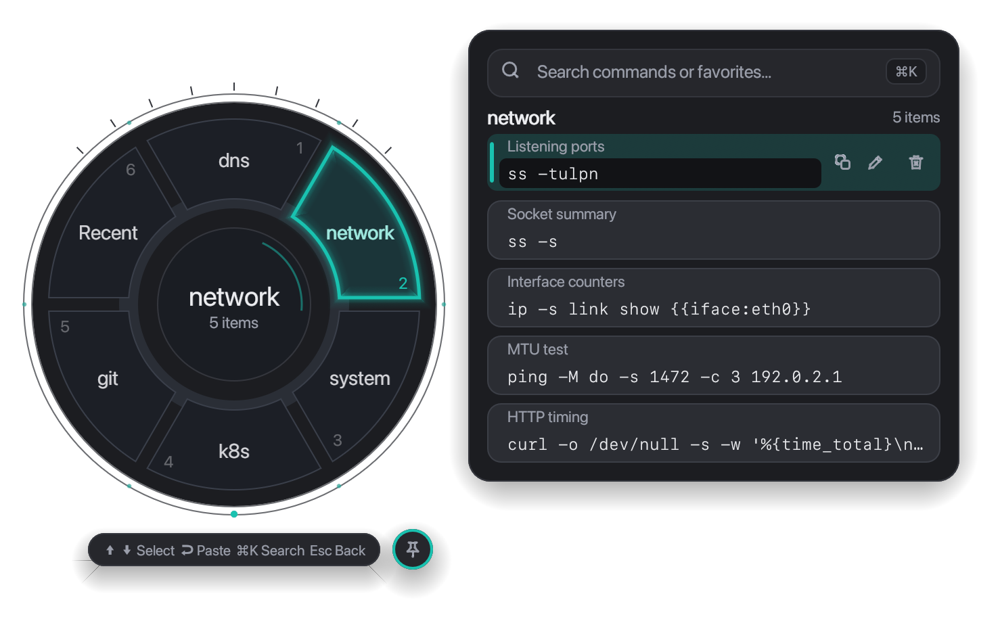
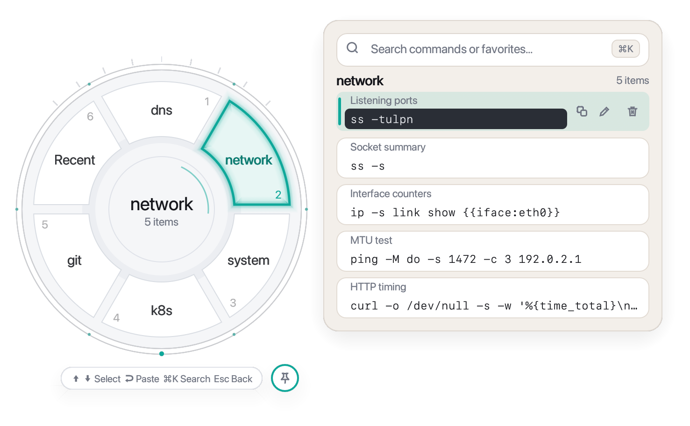
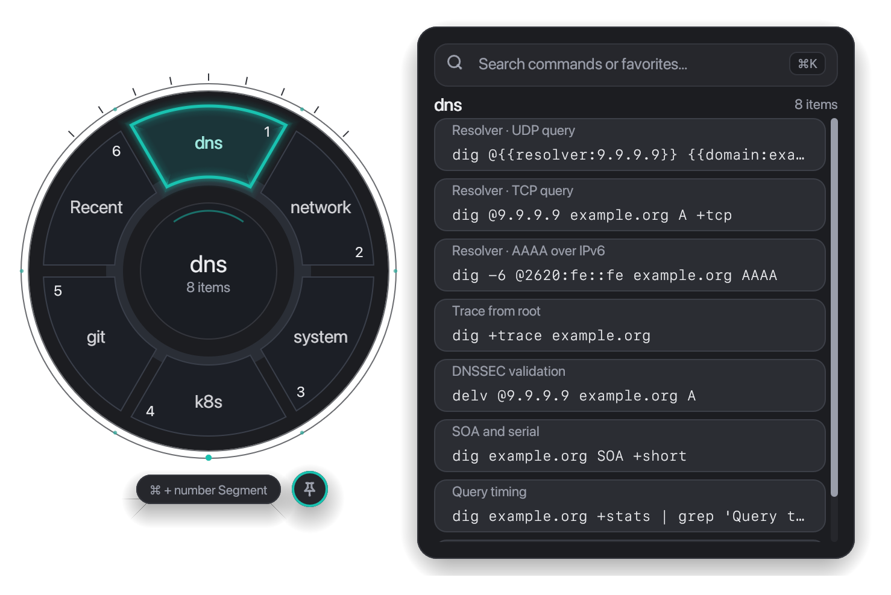
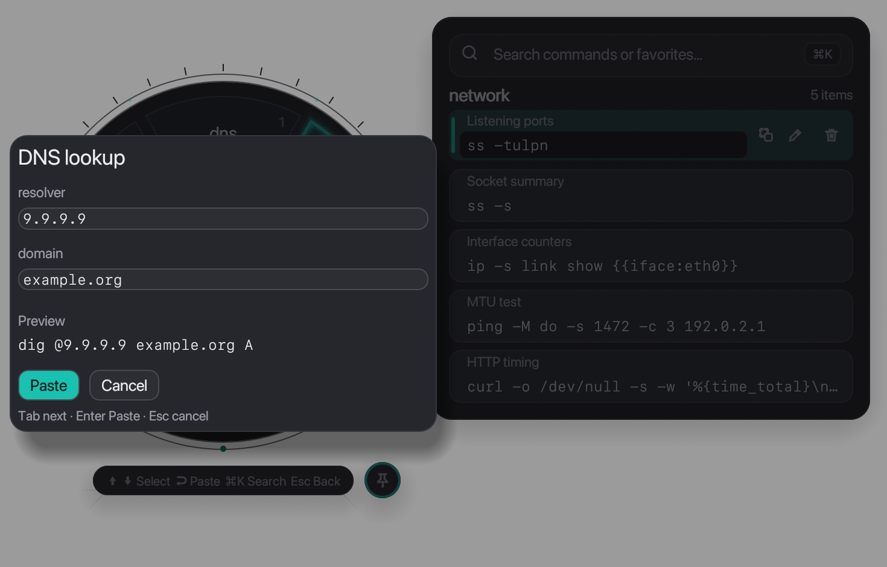
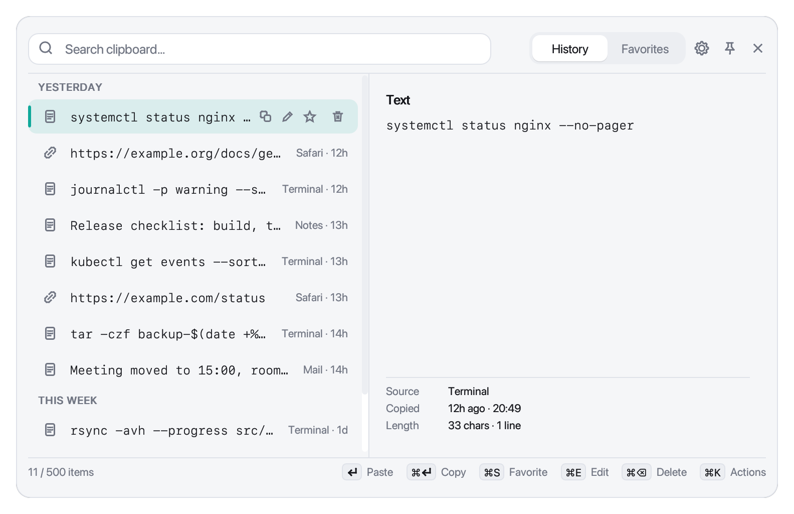

<div align="center">
  <h1>CopyWheel</h1>
  <p>A keyboard-first clipboard history and command wheel for macOS.</p>
  <p>
    <a href="https://github.com/guneskursad/copywheel/releases/latest"></a>
    <a href="LICENSE"></a>
    
  </p>
  <p><strong><a href="https://github.com/guneskursad/copywheel/releases/latest/download/CopyWheel.dmg">Download CopyWheel.dmg</a></strong></p>
</div>



## Two shortcuts

| Shortcut | Opens |
| --- | --- |
| `⌘⇧V` | The panel for History, Favorites, and Settings |
| `⌃⇧F` | The wheel |

## Tour

### Clipboard history

Search recent clips and preview their full content in the panel. Press Return to paste the selected clip.


### Favorites in groups

Save commands and reusable text as favorites. Organize them in color-coded groups that can nest inside one another.


### The wheel

Open a group from the wheel and choose a saved command from the list beside it. The wheel remembers your last segment and page.



### Jump with numbers

Hold Command to see the shortcut numbers. Press Command and a number to select a segment or use an item in the active list.



### Snippet variables

Add placeholders to a favorite. CopyWheel asks for their values before copying or pasting the snippet.

```text
dig @{{resolver:9.9.9.9}} {{domain:example.org}} A
```



### Light and dark

Follow the system appearance or pick Light or Dark in Settings.

<table>
  <tr>
    <td width="50%"></td>
    <td width="50%"></td>
  </tr>
</table>

### Settings

Change shortcuts, auto-paste, and how CopyWheel keeps your history. You can also import or export a backup.


## Install

1. Download the DMG, open it, and drag CopyWheel to Applications.
2. On first launch, right-click CopyWheel and choose **Open**. The app is unnotarized. If macOS still blocks it, see the install guide.
3. Grant CopyWheel **Accessibility** access to enable auto-paste.
4. Press `⌘⇧V` to open the panel.

See the [install guide](docs/INSTALL.md) for details.

## Keyboard shortcuts

<details>
<summary>Panel</summary>

| Key / Mouse | Action |
| --- | --- |
| Type | Search (search field is always focused) |
| `↑` `↓`, `⌃P` `⌃N`, `⌃K` `⌃J` | Move selection |
| Click | Select the row and show it in the preview pane (panel stays open) |
| Double-click | Paste (same as `↵`) |
| `↵` | Paste (auto-paste setting applies); toggle group when a group header is selected |
| `⌘↵` | Copy only and close (no auto-paste) |
| `⌘1`…`⌘9` | Paste row 1–9 (hold `⌘` to display badges) |
| `⌘S` | Open group picker (add to or move between favorites) |
| `⌘E` | Edit (history row opens new favorite editor; favorite opens its editor) |
| `⌘⌫` | Delete (no confirmation) |
| `⌘Z` | Undo the last delete (one level, clip or favorite) |
| `⌘K` | Open actions menu |
| `Tab` / `⇧Tab` | Switch between History and Favorites |
| Panel hotkey while open | Switch between History and Favorites |
| `→` / `←` | Expand / collapse group in Favorites |
| `⇧↑` `⇧↓`, `⌘A` | Mark range / mark all |
| `⌘,` | Open Settings |
| `Esc` | Close popup → clear marks → clear query → hide panel |

</details>

<details>
<summary>Wheel</summary>

The wheel reopens on the last used segment and page.

| Key | Action |
| --- | --- |
| Hold `⌘` | Show shortcut numbers for the active area |
| `⌘1`…`⌘9`, `⌘0` | Select a wheel segment, or paste/copy the numbered item when the side list is active |
| `←` / `→` | Move between wheel segments |
| `↑` / `↓` | Move selection in the side list |
| `⌘K` | Focus the search field |
| `↵` | Activate the selected segment or paste/copy the selected item |
| `⌘C` / `⌃C` | Copy the selected item |
| `⌘E` | Edit the selected row |
| `⌘⌫` | Delete the selected row |
| `⌘Z` | Undo the last delete |
| `⌘J` | Next page on the main wheel |
| `Esc` | Return from side list to wheel, go up one group level, or close |

</details>

## Privacy

- **Local storage only**. All clipboard history, favorites, and settings stay on your Mac under `~/Library/Application Support/CopyWheel/`. The directory uses mode `0700`. All stored files (`data.json`, `images/*`, temporary files, and exports) use mode `0600`.
- **No network access**. CopyWheel makes no outbound network requests and collects no telemetry.
- **Sensitive pasteboard filtering**. Items marked by password managers or macOS as concealed, transient, or auto-generated are skipped by default and never written to disk.
- **Plain-text exports**. Exported backup files are stored in plain text.

<details>
<summary>Build from source</summary>

Building requires a Rust toolchain, Xcode Command Line Tools, and macOS. Run these commands from the repository root.

```sh
# Build CopyWheel.app
scripts/make-app.sh

# Package a distributable DMG and SHA256SUMS in dist/
scripts/make-dmg.sh
```

</details>

## License

CopyWheel is licensed under the GNU Affero General Public License v3.0 only (AGPL-3.0-only). See [LICENSE](LICENSE).

Copyright © 2026 Kürşad Güneş
