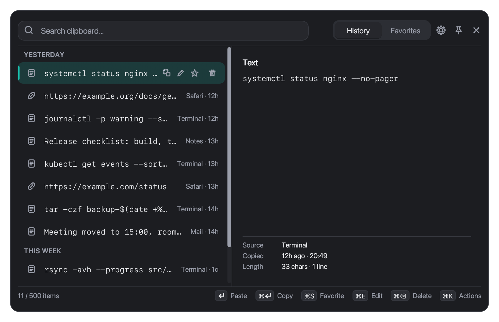
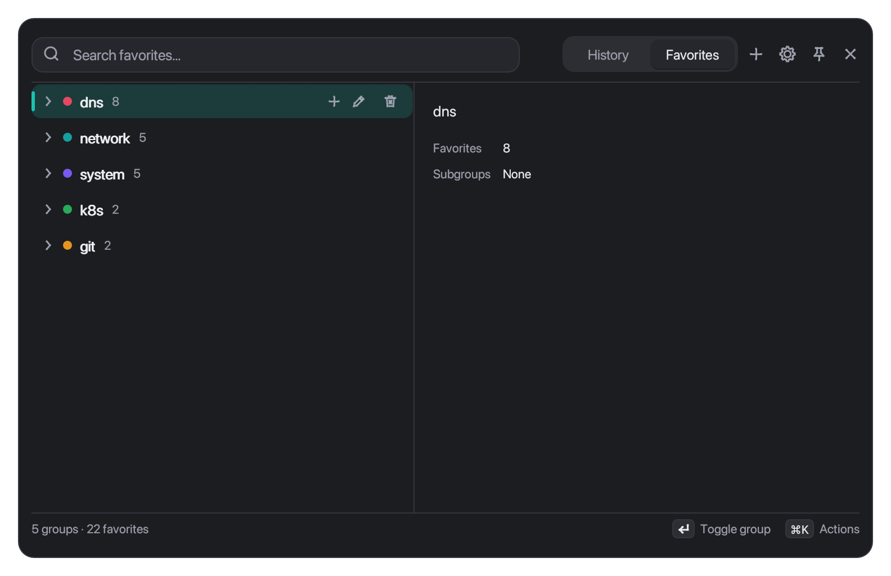
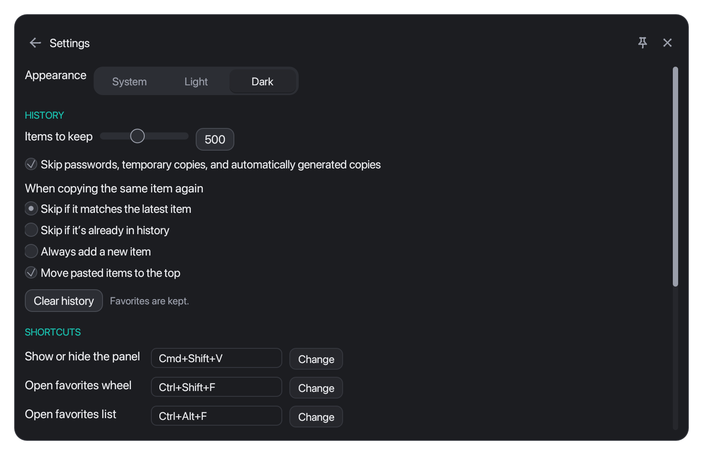

<div align="center">
  <h1>CopyWheel</h1>
  <p>A keyboard-first clipboard history and command wheel for macOS and Windows.</p>
  <p>
    <a href="https://github.com/guneskursad/copywheel/releases/latest"></a>
    <a href="LICENSE"></a>
    
  </p>
  <p>
    <strong><a href="https://github.com/guneskursad/copywheel/releases/latest/download/CopyWheel.dmg">Download for macOS</a></strong>
    &nbsp;·&nbsp;
    <strong><a href="https://github.com/guneskursad/copywheel/releases/latest/download/CopyWheel-Setup.exe">Download for Windows</a></strong>
  </p>
  <p><sub>Requirements: macOS 11+, Windows 10/11 x64</sub></p>
</div>


## Default shortcuts

| macOS | Windows | Opens |
| --- | --- | --- |
| `⌘⇧V` | `Ctrl+Shift+V` | The panel for History, Favorites, and Settings |
| `⌃⇧F` | `Ctrl+Alt+F` | The wheel |
| `⌃⌥F` | `Ctrl+Alt+Shift+F` | The searchable favorites list |

## Tour

### Clipboard history

Search recent clips and preview their full content in the panel. Press Return / Enter to paste the selected clip.



### Favorites in groups

Save commands and reusable text as favorites. Organize them in color-coded groups that can nest inside one another.



### The wheel

Open a group from the wheel and choose a saved command from the list beside it. The wheel remembers your last segment and page.


### Jump with numbers

Hold Command (macOS) or Ctrl (Windows) to see the shortcut numbers. Press it with a number to select a segment or use an item in the active list.


### Snippet variables

Add placeholders to a favorite. CopyWheel asks for their values before copying or pasting the snippet.

```text
dig @{{resolver:9.9.9.9}} {{domain:example.org}} A
```


### Light and dark

Follow the system appearance or pick Light or Dark in Settings.

<table>
  <tr>
    <td width="50%"></td>
    <td width="50%"></td>
  </tr>
</table>

### Settings

Change shortcuts, auto-paste, start at login (on by default in **Settings > General**), and how CopyWheel keeps your history. You can also import or export a backup.



## Install

Requirements: macOS 11+, Windows 10/11 x64.

**macOS:**
1. Download [`CopyWheel.dmg`](https://github.com/guneskursad/copywheel/releases/latest/download/CopyWheel.dmg), open it, and drag CopyWheel to **Applications**.
2. On first launch, right-click CopyWheel and choose **Open**. The app is unnotarized. If macOS still blocks it, see the install guide.
3. Grant CopyWheel **Accessibility** access to enable auto-paste.
4. Press `⌘⇧V` to open the panel.

**Windows:**
1. Download and run [`CopyWheel-Setup.exe`](https://github.com/guneskursad/copywheel/releases/latest/download/CopyWheel-Setup.exe). It installs per user without administrator privileges.
2. If Windows SmartScreen warns that the installer is unrecognized, click **More info** and then **Run anyway**.
3. Press `Ctrl+Shift+V` to open the panel.

**Start at login** is enabled by default on both platforms and can be toggled in **Settings > General**.

See the [install guide](docs/INSTALL.md) for full instructions, checksum verification, and uninstall steps.

## Keyboard shortcuts

<details>
<summary>Panel</summary>

| macOS | Windows | Action |
| --- | --- | --- |
| Type | Type | Search (search field is always focused) |
| `↑` `↓`, `⌃P` `⌃N`, `⌃K` `⌃J` | `↑` `↓`, `Ctrl+P` `Ctrl+N`, `Ctrl+K` `Ctrl+J` | Move selection |
| Click | Click | Select the row and show it in the preview pane (panel stays open) |
| Double-click | Double-click | Paste (same as `↵` / `Enter`) |
| `↵` | `Enter` | Paste (auto-paste setting applies); toggle group when a group header is selected |
| `⌘↵` | `Ctrl+Enter` | Copy only and close (no auto-paste) |
| `⌘1`…`⌘9` | `Ctrl+1`…`Ctrl+9` | Paste row 1–9 (hold `⌘` / `Ctrl` to display badges) |
| `⌘S` | `Ctrl+S` | Open group picker (add to or move between favorites) |
| `⌘E` | `Ctrl+E` | Edit (history row opens new favorite editor; favorite opens its editor) |
| `⌘⌫` | `Ctrl+Backspace` | Delete (no confirmation) |
| `⌘Z` | `Ctrl+Z` | Undo the last delete (one level, clip or favorite) |
| `⌘K` | `Ctrl+K` | Open actions menu |
| `Tab` / `⇧Tab` | `Tab` / `Shift+Tab` | Switch between History and Favorites |
| Panel hotkey while open | Panel hotkey while open | Switch between History and Favorites |
| `→` / `←` | `→` / `←` | Expand / collapse group in Favorites |
| `⇧↑` `⇧↓`, `⌘A` | `Shift+↑` `Shift+↓`, `Ctrl+A` | Mark range / mark all |
| `⌘,` | `Ctrl+,` | Open Settings |
| `Esc` | `Esc` | Close popup → clear marks → clear query → hide panel |

</details>

<details>
<summary>Wheel</summary>

The wheel reopens on the last used segment and page.

| macOS | Windows | Action |
| --- | --- | --- |
| Hold `⌘` | Hold `Ctrl` | Show shortcut numbers for the active area |
| `⌘1`…`⌘9`, `⌘0` | `Ctrl+1`…`Ctrl+9`, `Ctrl+0` | Select a wheel segment, or paste/copy the numbered item when the side list is active |
| `←` / `→` | `←` / `→` | Move between wheel segments |
| `↑` / `↓` | `↑` / `↓` | Move selection in the side list |
| `⌘K` | `Ctrl+K` | Focus the search field |
| `↵` | `Enter` | Activate the selected segment or paste/copy the selected item |
| `⌘C` / `⌃C` | `Ctrl+C` | Copy the selected item |
| `⌘E` | `Ctrl+E` | Edit the selected row |
| `⌘⌫` | `Ctrl+Backspace` | Delete the selected row |
| `⌘Z` | `Ctrl+Z` | Undo the last delete |
| `⌘J` | `Ctrl+J` | Next page on the main wheel |
| `Esc` | `Esc` | Return from side list to wheel, go up one group level, or close |

</details>

## Privacy

- **Local storage only**. All clipboard history, favorites, and settings stay on your machine:
  - **macOS:** `~/Library/Application Support/CopyWheel/` (directory mode `0700`; `data.json`, `images/*`, temporary files, and exports use mode `0600`).
  - **Windows:** `%APPDATA%\CopyWheel\` in your user profile.
- **No network access**. CopyWheel makes no outbound network requests and collects no telemetry.
- **Sensitive clipboard filtering**. Items marked by password managers or the OS as concealed, transient, or auto-generated are skipped by default and never written to disk.
- **Plain-text exports**. Exported backup files are stored in plain text.

<details>
<summary>Build from source</summary>

**macOS** (requires Rust toolchain and Xcode Command Line Tools):

```sh
# Build CopyWheel.app
scripts/make-app.sh

# Package a distributable DMG and SHA256SUMS in dist/
scripts/make-dmg.sh
```

**Windows** (requires Rust toolchain and Inno Setup 6 for the installer):

```powershell
# Build copywheel.exe
cargo build --release --locked

# Build CopyWheel-Setup.exe in dist\
iscc installer\windows\copywheel.iss
```

</details>

## License

CopyWheel is licensed under the GNU Affero General Public License v3.0 only (AGPL-3.0-only). See [LICENSE](LICENSE).

Copyright © 2026 Kürşad Güneş
