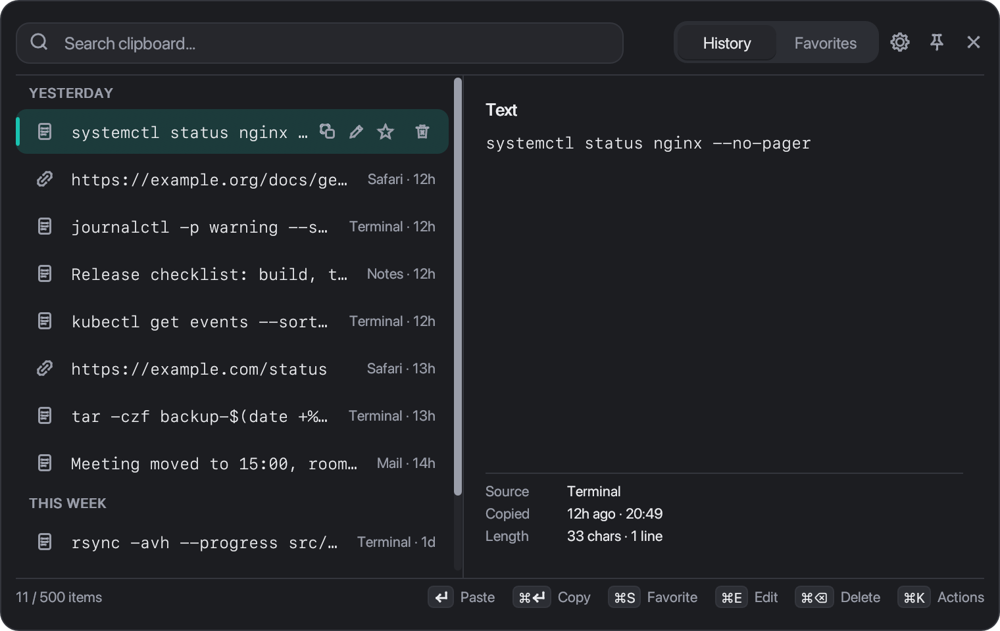

# CopyWheel

Keyboard-first clipboard history, command favorites, and radial wheel for macOS.

CopyWheel keeps your clipboard history and saved commands a single keystroke away in a fast native macOS utility. Browse and search recent clips in a two-pane panel with a full content preview, or launch frequently used commands from a radial wheel organized by nested groups. Everything runs locally on your Mac with zero network access and full dark mode support.

## Screenshots

| Clipboard history & preview | Radial wheel | Snippet variable prompt |
| --- | --- | --- |
|  |  |  |

## Features

- **Two-pane panel with preview** — Browse clipboard history or favorites on the left while reading the full, unwrapped content and metadata (source app, timestamp, length) on the right.
- **Fuzzy search with frecency** — Instant filtering across clipboard text, source app, favorite titles, and group paths, ranked by match quality and frecency (frequency + recency).
- **Favorites in nested groups** — Organize reusable commands and text snippets into collapsible, arbitrarily nested groups with color markers.
- **Radial wheel** — Trigger a circular launcher to jump into command groups and paste items with `⌘1`–`⌘9` or arrow keys; reopens on the last used segment and page.
- **Snippet variables** — Parameterize commands with `{{name}}` and `{{name:default}}` placeholders and fill them in a keyboard-driven prompt before pasting.
- **Dark mode** — Follows macOS System appearance automatically or switches manually between Light and Dark themes in Settings.
- **Password-manager protection** — Automatically skips concealed, transient, and auto-generated pasteboard items so copied passwords are not stored.
- **Local only** — All data stays on your Mac with no cloud sync, telemetry, or network connections.

## Install

Download the latest `.dmg` archive from the Releases page, open it, and drag `CopyWheel.app` into your `Applications` folder. See [docs/INSTALL.md](docs/INSTALL.md) for Gatekeeper first-open steps, Accessibility permission setup for auto-paste, data locations, and uninstall instructions.

## Build from source

Building requires a Rust toolchain, Xcode Command Line Tools, and macOS. From the repository root:

```bash
# Build CopyWheel.app
scripts/make-app.sh

# Package a distributable DMG and SHA256SUMS in dist/
scripts/make-dmg.sh
```

## Keyboard shortcuts

### Global hotkeys

Default shortcuts can be customized in **Settings** (`⌘,`):

| Shortcut | Action |
| --- | --- |
| `⌘⇧V` | Open the History panel (press again while open to toggle History ↔ Favorites) |
| `⌃⌥F` | Open the Favorites panel |
| `⌃⇧F` | Open the radial wheel |

### Panel

| Key / Mouse | Action |
| --- | --- |
| Type | Search (search field is always focused) |
| `↑` `↓`, `⌃P` `⌃N`, `⌃K` `⌃J` | Move selection |
| Click | Select the row and show it in the preview pane (panel stays open) |
| Double-click | Paste (same as `↵`) |
| `↵` | Paste (auto-paste setting applies); toggle group when a group header is selected |
| `⌘↵` | Copy only and close (no auto-paste) |
| `⌘1`…`⌘9` | Paste row 1–9 (hold `⌘` to display badges) |
| `⌘S` | Open group picker (add to or move between favorites) |
| `⌘E` | Edit (history row opens new favorite editor; favorite opens its editor) |
| `⌘⌫` | Delete (no confirmation) |
| `⌘Z` | Undo the last delete (one level, clip or favorite) |
| `⌘K` | Open actions menu |
| `Tab` / `⇧Tab` | Switch between History and Favorites |
| Panel hotkey while open | Switch between History and Favorites |
| `→` / `←` | Expand / collapse group in Favorites |
| `⇧↑` `⇧↓`, `⌘A` | Mark range / mark all |
| `⌘,` | Open Settings |
| `Esc` | Close popup → clear marks → clear query → hide panel |

### Wheel

The wheel reopens on the last used segment and page.

| Key | Action |
| --- | --- |
| Hold `⌘` | Show shortcut numbers for the active area |
| `⌘1`…`⌘9`, `⌘0` | Select a wheel segment, or paste/copy the numbered item when the side list is active |
| `←` / `→` | Move between wheel segments |
| `↑` / `↓` | Move selection in the side list |
| `⌘K` | Focus the search field |
| `↵` | Activate the selected segment or paste/copy the selected item |
| `⌘C` / `⌃C` | Copy the selected item |
| `⌘E` | Edit the selected row |
| `⌘⌫` | Delete the selected row |
| `⌘Z` | Undo the last delete |
| `⌘J` | Next page on the main wheel |
| `Esc` | Return from side list to wheel, go up one group level, or close |

## Snippet variables

Any favorite can include placeholders using `{{name}}` or `{{name:default}}`, where `name` uses `[A-Za-z0-9_.-]`.

```text
dig @{{resolver:9.9.9.9}} {{domain:example.org}} A
```

When you paste or copy a favorite containing variables, CopyWheel opens a compact prompt with one input per variable in order of first appearance. Each field is prefilled with the last value you used for that variable (or its default if none has been saved yet). Press `Tab` / `⇧Tab` to move between fields, `↵` to fill and paste, or `Esc` to cancel.

## Privacy

- **Local storage only**: All clipboard history, favorites, and settings stay on your Mac under `~/Library/Application Support/CopyWheel/`. The directory is created with mode `0700` and all stored files (`data.json`, `images/*`, temporary files, and exports) are written with mode `0600`.
- **No network access**: CopyWheel makes no outbound network requests and collects no telemetry.
- **Sensitive pasteboard filtering**: Items marked by password managers or macOS as concealed, transient, or auto-generated are skipped by default and never written to disk.
- **Plain-text exports**: Exported backup files are stored in plain text; handle them accordingly when sharing or backing up.

## License

CopyWheel is licensed under the **GNU Affero General Public License v3.0 only** (`AGPL-3.0-only`). See [LICENSE](LICENSE) for the full text.

Copyright © 2026 Kürşad Güneş
